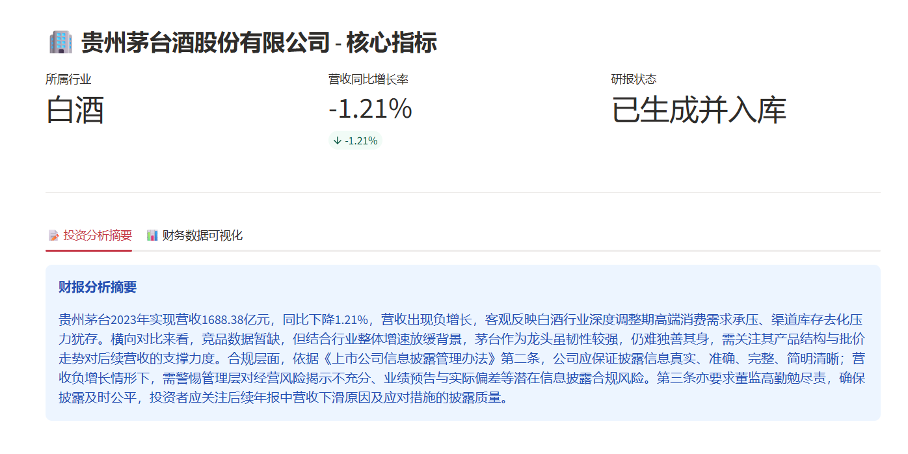

# 📊 智能财报与合规分析系统 (Full-Stack AI Agent)


基于 **LangGraph + RAG + Milvus** 构建的全栈智能财报分析系统。上传财报 PDF，系统将自动提取核心财务指标、联网搜索同行竞品数据，并结合私有合规知识库（如《上市公司信息披露管理办法》），一键生成带合规风险提示的专业投资研报。

## 🚀 核心功能

- **多模态文档解析**：基于 `pdfplumber` 提取长篇幅财报核心数据，支持脏数据容错与单位自动换算。
- **AI 智能体编排**：基于 LangGraph 构建 `提取 -> 计算 -> 搜索 -> 检索 -> 总结 -> 落库` 六节点流水线。
- **RAG 知识库增强**：结合 Milvus 向量数据库与 BGE 中文词向量模型，实现财报数据与法规条款的交叉验证，自动生成合规风险提示。
- **外部工具调用**：结合 Tavily Search 实时抓取同行业竞品数据，实现横向对比分析。
- **高可靠校验与评测**：结合 Pydantic 强约束大模型输出格式，引入 **LLM-as-a-Judge** 自动化评测流水线，杜绝财务数据提取幻觉。
- **全栈前后端分离**：FastAPI 提供高性能异步 API，Streamlit + Plotly 构建交互式数据看板。
- **数据持久化**：解析结果、RAG 引用与研报自动存入 PostgreSQL 数据库。

## 🛠️ 技术栈

`Python` | `LangChain` | `LangGraph` | `DeepSeek` | `FastAPI` | `Streamlit` | `Milvus` | `PostgreSQL` | `Plotly` | `HuggingFace`

## 📸 核心功能演示



## 📊 模型效果评测 (Evaluation)

本项目引入了基于 **LLM-as-a-Judge** 的自动化评测流水线（见 `eval/run_eval.py`），旨在量化评估大模型在长文本财务数据提取时的准确性与抗幻觉能力。
*   **评测机制**：构建包含多行业（白酒、新能源、互联网）财报的结构化评测数据集（Ground Truth），将 Agent 提取结果与标准答案交由裁判模型进行交叉比对。
*   **当前评测结果**：在基准测试集上，核心财务指标提取的 **Accuracy 达到 100%**（3/3 通过），有效验证了 Pydantic 强约束与 Prompt 优化的可靠性。

## ⚙️ 快速启动

请先在根目录新建 `.env` 文件填入密钥（如 `DEEPSEEK_API_KEY`、`TAVILY_API_KEY` 及数据库连接串等），然后在终端中一键执行以下全流程命令：

```bash
# 1. 克隆仓库并安装依赖
git clone https://github.com/xyj7157/Smart-Report-Analyzer.git
cd Smart-Report-Analyzer
pip install -r requirements.txt

# 2. 启动向量数据库 (Milvus) - 请确保已启动 Docker Desktop
docker compose -f docker-compose-milvus.yml up -d

# 3. 构建 RAG 知识库 (将合规法条向量化并存入 Milvus)
python core/build_kb.py

# 4. 启动后端 (FastAPI)
# 请在新的终端窗口中运行：
python -m uvicorn api:app --reload

# 5. 启动前端 (Streamlit)
# 请再开一个新的终端窗口运行：
streamlit run frontend.py